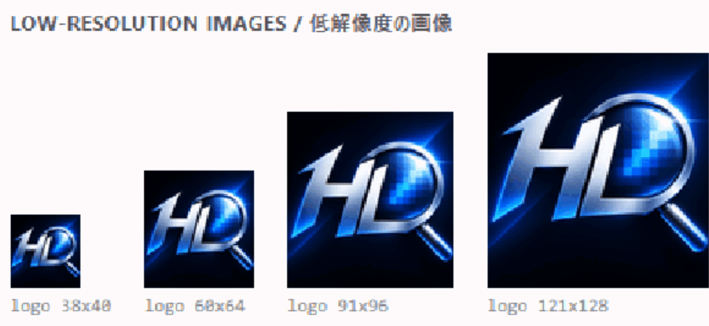
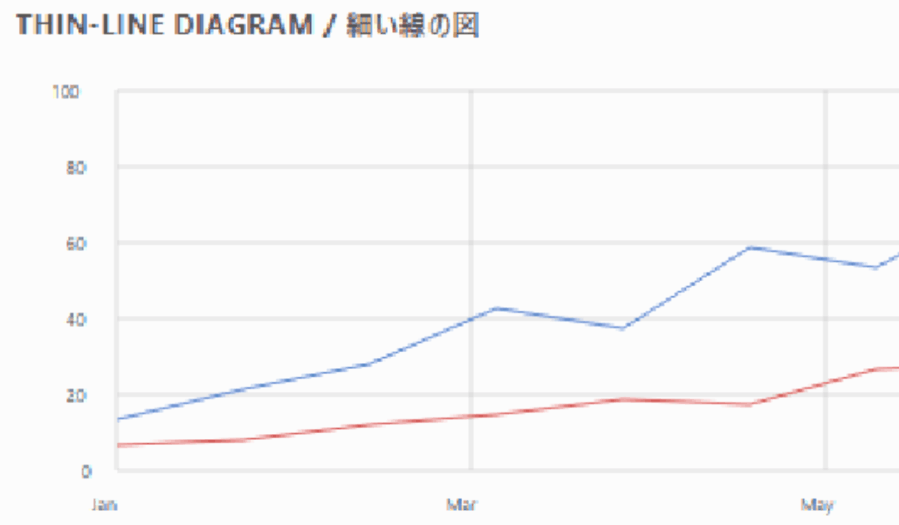
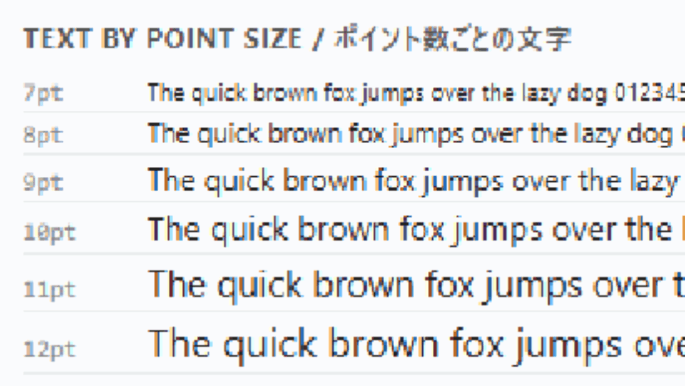
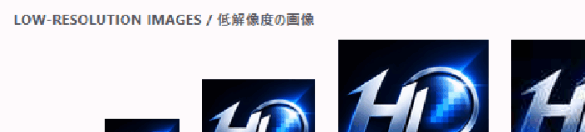
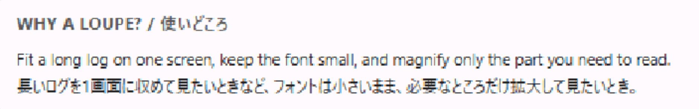

# HiResLoupe / 高解像ルーペ

[English](#en) | [日本語](#ja)

<a id="en"></a>

## English

A small tray tool that magnifies the desktop around the mouse pointer in real time and enhances it to high resolution with the super resolution of the NVIDIA RTX Video SDK. Handy for small icons, diagrams and illustrations.

**No installer.** Unzip and run `HiResLoupe.exe`.

### See the difference

Windows 11 Magnifier (lens view, 400%) on the left, HiResLoupe (400%) on the right. Same screen, same position. The divider sweeps across the picture.

**Small, low-resolution pictures** (the logo shrunk to 38–121 px): the edges stay smooth instead of turning into blocks. 

### Left: Windows Magnifier, right: HiResLoupe



**Thin lines and small numbers.** Left: Windows Magnifier, right: HiResLoupe.



**Small text, 7 pt to 12 pt.** Left: Windows Magnifier, right: HiResLoupe.



<details>
<summary>More comparisons</summary>

**Low-resolution pictures, another position.** Left: Windows Magnifier, right: HiResLoupe.



**Text.** Left: Windows Magnifier, right: HiResLoupe.



</details>

The two screenshots of each pair were taken on the same screen, then aligned and cropped to the same area. The GIF format reduces the colors to 256. How much difference you see depends on what is on the screen; it is largest on small text, thin lines and low-resolution pictures.

### Why HiResLoupe

- **Sharper picture.** Super resolution instead of plain enlargement (see above).
- **Zoom with the mouse wheel.** 25% steps, from 100% up to 400% (200% at start).
- **Resize it while you use it.** Hold `Ctrl` and drag the edge of the loupe (or turn the wheel with `Ctrl` held). Keys `1` / `2` / `3` switch between shape presets: a square, a wide 16:9 and a tall 16:9.
- **Stays on the screen.** The loupe never leaves the monitor. At the edge it stops, and the magnified area keeps following the pointer, so you can read right up to the edge of the screen. With several monitors, it moves to the monitor the pointer is on.
- **Pin it in place (v1.1).** `Ctrl` + `Space` pins the loupe where it is, while its view keeps following the pointer. Move the pointer anywhere, even onto another monitor, and read it in the pinned loupe. While pinned, `Wheel` scrolls the app underneath and `Ctrl` + `Wheel` zooms.
- **Out of the way.** Show / hide with `Win` + `Alt` + `Z`, close with `Esc` or `Ctrl` + `Right-click` (a plain right-click goes to the app underneath). Shortcuts can be changed from the tray menu. It lives in the system tray and needs no installer.

### Download

Go to [Releases](../../releases) and download **`HiResLoupe.zip`**.
(Do not download the automatic "Source code (zip)" / "Source code (tar.gz)" files. They contain the source only and no `.exe`.)

### Requirements

- An NVIDIA RTX series GPU
- Windows 11 (tested). Windows 10 (version 2004 or later) is untested, but it may work. If you try it on Windows 10, please tell us the result in [Issues](../../issues): your Windows version, GPU and driver version, and whether it worked.

### Quick start

1. Unzip `HiResLoupe.zip` and double-click `HiResLoupe.exe`. The loupe appears and the app stays in the system tray.
2. Show / hide the loupe: `Win` + `Alt` + `Z`. Quit: right-click the tray icon, then "Quit".
3. See [MANUAL.md](MANUAL.md) for all controls and settings.

### Build from source

Needs Visual Studio 2022 (C++ tools) and the NVIDIA RTX Video SDK. The SDK is not included in this repository; get it from NVIDIA and accept its license.

```powershell
.\build.ps1 -Sdk <path to the NVIDIA RTX Video SDK>
```

The path can also be given in the `NV_RTX_VIDEO_SDK` environment variable. The build puts `HiResLoupe.exe` and `nvngx_vsr.dll` in the project folder.

### License

The source code and the app are released under the [MIT License](LICENSE). `nvngx_vsr.dll` is part of the NVIDIA RTX Video SDK and follows NVIDIA's terms (see [NOTICE.txt](NOTICE.txt)).
The logo and icon were generated with ChatGPT. If you build something based on this software, we would appreciate a mention of "HiResLoupe" and "Nanakagi" (not required).
NVIDIA and NVIDIA RTX are trademarks or registered trademarks of NVIDIA Corporation. This app is an independent work and is not provided, endorsed or approved by NVIDIA.

### Author

Nanakagi

<!-- 作者リンク(Twitch など)と支援の窓口は、ここに追記する -->

---

<a id="ja"></a>

## 日本語

マウスの位置を中心にデスクトップ画面をリアルタイムで拡大し、NVIDIA RTX Video SDK の超解像で高解像度に補正して見る、タスクトレイ常駐の小さなツールです。小さなアイコンや図、イラストを見るときに便利です。

**インストールは要りません。** zip を展開して `HiResLoupe.exe` を起動するだけで使えます。

### 違いを見る

左が Windows 11 の拡大鏡(レンズ表示・400%)、右が HiResLoupe(400%)です。同じ画面の同じ場所で、境界の線が左右に動きます。

**小さな低解像度の画像**(ロゴを 38〜121px に縮めたもの): 縁がブロック状にならず、なめらかなままです。  

### 左: Windows 拡大鏡、右: HiResLoupe


**細い線と小さな数字。**左: Windows 拡大鏡、右: HiResLoupe。


**小さな文字(7pt〜12pt)。**左: Windows 拡大鏡、右: HiResLoupe。


<details>
<summary>もっと見る</summary>

**低解像度の画像(別の位置)。**左: Windows 拡大鏡、右: HiResLoupe。


**文字。**左: Windows 拡大鏡、右: HiResLoupe。


</details>

どの組も、同じ画面で撮った2枚のスクリーンショットを、位置を合わせて同じ範囲に切り出したものです。GIF の形式の都合で、色は 256 色に減っています。差の大きさは画面に映っているものによって変わります。小さな文字、細い線、低解像度の画像で、一番大きく出ます。

### 特長

- **くっきり見える。** 単なる拡大ではなく超解像で補正します(上の比較を見てください)。
- **マウスのホイールで倍率を変えられる。** 25% 刻みで、100%〜400%(起動時は 200%)。
- **使いながら大きさを変えられる。** `Ctrl` を押したままルーペの縁をつかんで動かします(`Ctrl` + ホイールでも変えられます)。数字キーの `1` / `2` / `3` で、「形のテンプレート」(正方形・横長 16:9・縦長 16:9)に切り替えます。
- **画面の外に出ない。** ルーペはモニターの外に出ません。端では止まり、拡大される範囲はポインタに付いていくので、画面の端のぎりぎりまで読めます。モニターが複数あるときは、ポインタのあるモニターへ移ります。
- **その場に固定できる(v1.1)。** `Ctrl` + `Space` でルーペの窓だけを止め、中身はポインタを追い続けます。ポインタを好きな所へ(別のモニターへも)動かして、固定したルーペで読めます。固定中は `ホイール` で下のアプリをスクロールし、`Ctrl` + `ホイール` で倍率を変えます。
- **邪魔にならない。** `Win` + `Alt` + `Z` で出し入れし、`Esc` か `Ctrl` + `右クリック` で閉じます(ただの右クリックは下のアプリに通ります)。ショートカットはトレイのメニューから変えられます。タスクトレイに常駐し、インストールは要りません。

### ダウンロード

[Releases](../../releases) から **`HiResLoupe.zip`** をダウンロードしてください。
(自動で付く「Source code (zip)」「Source code (tar.gz)」は、ソースだけで `.exe` が入っていません。落とさないでください。)

### 必要なもの

- NVIDIA RTX シリーズの GPU
- Windows 11(動作確認済み)。Windows 10(2004 以降)は未確認ですが、動く可能性があります。試した方は、Windows のバージョン、GPU とドライバーのバージョン、動いたかどうかを [Issues](../../issues) で教えてください。

### 使い始める

1. `HiResLoupe.zip` を展開して `HiResLoupe.exe` をダブルクリックします。ルーペが出て、タスクトレイに常駐します。
2. ルーペを出す / 消す: `Win` + `Alt` + `Z`。終了: トレイのアイコンを右クリック →「アプリを終了」。
3. 操作と設定は [MANUAL.md](MANUAL.md) を見てください。

### ソースからビルドする

Visual Studio 2022(C++ ツール)と NVIDIA RTX Video SDK が必要です。SDK はこのリポジトリに含まれていません。NVIDIA から入手し、その使用許諾に同意してください。

```powershell
.\build.ps1 -Sdk <NVIDIA RTX Video SDK のフォルダ>
```

SDK の場所は、環境変数 `NV_RTX_VIDEO_SDK` でも指定できます。ビルドすると、プロジェクトのフォルダに `HiResLoupe.exe` と `nvngx_vsr.dll` ができます。

### ライセンス

ソースコードとアプリ本体は [MIT License](LICENSE) で公開しています。`nvngx_vsr.dll` は NVIDIA RTX Video SDK の一部で、NVIDIA の条件に従います([NOTICE.txt](NOTICE.txt) を参照)。
ロゴとアイコンは ChatGPT で生成したものです。このソフトを元に何かを作ったときは、アプリ名「HiResLoupe」と作者名「Nanakagi」を載せてもらえると嬉しいです(必須ではありません)。
NVIDIA、NVIDIA RTX は NVIDIA Corporation の商標または登録商標です。本アプリは個人が作ったもので、NVIDIA が提供・推奨・承認したものではありません。

### 作者

Nanakagi
